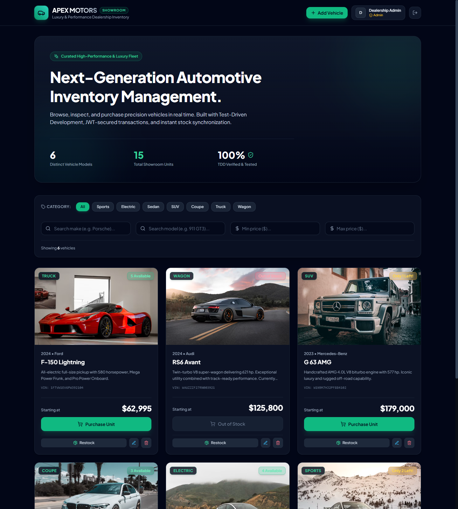
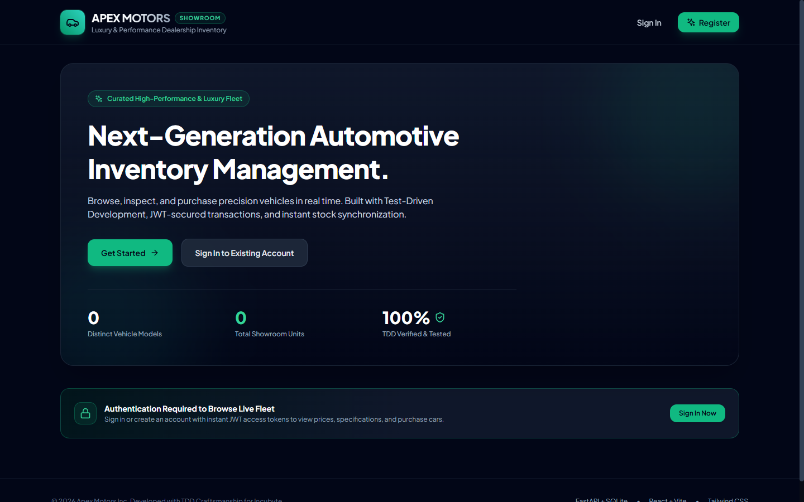
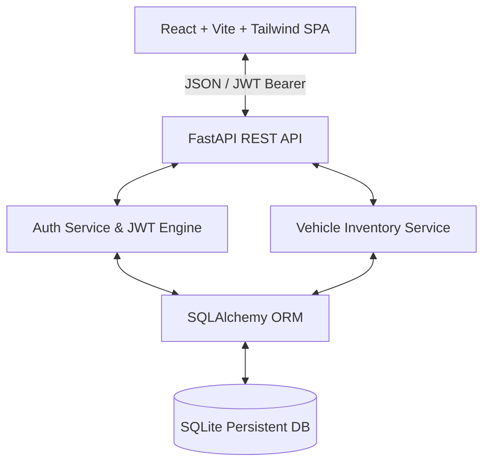

# Apex Motors — Car Dealership Inventory System

[](https://fastapi.tiangolo.com)
[](https://react.dev)
[](https://tailwindcss.com)
[](https://www.python.org)
[](https://pytest.org)
[](./TEST_REPORT.md)

A production-grade, test-driven full-stack Car Dealership Inventory System built for the **Incubyte Software Craftsperson** assessment. Engineered with eXtreme Programming (XP) values, disciplined Test-Driven Development (Red-Green-Refactor), secure JWT role-based access control, and a responsive luxury automotive user experience.

---

## Application Showcase



*Figure 1: Apex Motors luxury vehicle catalog displaying active inventory, real-time stock indicators, and administrative management controls.*



*Figure 2: Welcome landing page and authentication barrier protecting dealership endpoints.*

---

## 1. Project Overview & Key Features

### Key Features
- **Strict Test-Driven Development (TDD):** 100% backend business logic verified via Pytest prior to controller implementation. 15 comprehensive unit and integration tests passing with 95% total code coverage.
- **Role-Based Access Control (RBAC):** JWT Bearer authentication separating regular buyers from dealership managers (Administrators).
- **Vehicle Catalog Management:** Full CRUD operations for vehicles including Make, Model, Category, Price, Quantity, Model Year, VIN, and specs.
- **Stock-Managed Purchases:** Authenticated users can purchase vehicles in real time. Transactions automatically decrement unit stock and enforce zero-stock purchase guards.
- **Administrative Restocking & Fleet Controls:** Administrators can restock units, modify vehicle pricing/attributes, or delete entries.
- **Multi-Parameter Search & Filtering:** Filter vehicles dynamically by make, model, category, minimum price, and maximum price with instant reactive feedback.
- **FastAPI OpenAPI/Swagger Documentation:** Interactive API testing directly at `http://localhost:8000/docs`.
- **Modern Responsive UI:** Single Page Application (SPA) designed with React, Tailwind CSS, Lucide icons, glassmorphism card layouts, and auto-dismissing toast feedback.

---

## 2. Architecture & Technology Stack



### Backend
- **Framework:** Python 3.14+ with FastAPI
- **ORM / Database:** SQLAlchemy 2.0 with persistent SQLite (`dealership.db`)
- **Data Validation:** Pydantic V2 schemas and Email-Validator
- **Authentication:** JWT access tokens (`pyjwt`) with PBKDF2 HMAC-SHA256 password hashing
- **Testing:** Pytest, Pytest-Cov, and HTTPX / Starlette TestClient

### Frontend
- **Framework:** React 18 with Vite
- **Styling:** Tailwind CSS with modern automotive dark palette
- **Icons:** Lucide React
- **HTTP Client:** Native Fetch with automatic JWT interception and 401 handling

---

## 3. Project Directory Structure

```text
car-dealership-inventory-system/
├── backend/
│   ├── app/
│   │   ├── core/           # Config, database engine, security & JWT utilities
│   │   ├── models/         # SQLAlchemy ORM models (User, Vehicle)
│   │   ├── schemas/        # Pydantic validation schemas
│   │   ├── services/       # Decoupled business logic (AuthService, VehicleService)
│   │   ├── routers/        # FastAPI route handlers (/auth, /vehicles)
│   │   └── main.py         # App factory, CORS, and endpoint mounting
│   ├── tests/
│   │   ├── conftest.py     # In-memory SQLite fixtures and test client setup
│   │   ├── test_auth.py    # Registration, duplicate check, and login tests
│   │   └── test_vehicles.py# Inventory CRUD, filtering, purchase & restock tests
│   ├── create_admin.py     # CLI utility to create or promote administrator accounts
│   ├── seed.py             # Demo dataset seeding script
│   └── requirements.txt    # Pinned Python dependencies
├── frontend/
│   ├── src/
│   │   ├── api/            # API client with token storage and error handling
│   │   ├── context/        # AuthContext managing user session & credentials
│   │   ├── components/     # Navbar, Hero, SearchFilters, VehicleCard, Modals, Toast
│   │   ├── App.jsx         # Main dealership dashboard
│   │   ├── main.jsx        # App entry point
│   │   └── index.css       # Tailwind CSS directives
│   ├── package.json
│   ├── vite.config.js
│   └── tailwind.config.js
├── screenshots/            # Verified application preview screenshots
├── .env.example            # Environment variable template
├── .gitignore              # Ignores venv, node_modules, .db, .env
├── PROMPTS.md              # Verbatim AI prompt logs and transcript notes
├── TEST_REPORT.md          # Genuine test execution results and coverage metrics
└── README.md
```

---

## 4. Prerequisites

- **Python:** 3.10 or higher (Tested on Python 3.14.2)
- **Node.js:** 18.x or higher (Tested on Node v24.12.0)
- **Git**

---

## 5. Quickstart & Installation

### Step 1: Clone Repository
```bash
git clone https://github.com/Sonaksh07/car-dealership-inventory-system.git
cd car-dealership-inventory-system
```

### Step 2: Backend Setup
```bash
# 1. Create and activate virtual environment
python -m venv backend/venv

# Windows:
backend\venv\Scripts\activate
# macOS / Linux:
# source backend/venv/bin/activate

# 2. Install dependencies
pip install -r backend/requirements.txt

# 3. Seed demonstration database (Creates demo admin and 6 vehicles)
python backend/seed.py

# 4. Start backend server
python -m uvicorn app.main:app --app-dir backend --port 8000 --reload
```
The backend API is now running at `http://localhost:8000` with Swagger documentation at `http://localhost:8000/docs`.

### Step 3: Frontend Setup
Open a new terminal window:
```bash
cd frontend

# Install dependencies
npm install

# Start Vite development server
npm run dev
```
Open `http://localhost:5173` in your browser.

---

## 6. Seed Accounts & Administrator Setup

The seeding script (`python backend/seed.py`) configures two ready-to-use accounts for immediate testing:

| Role | Email | Password | Permissions |
| :--- | :--- | :--- | :--- |
| **Administrator** | `admin@dealership.com` | `Admin@Apex2026!` | Add, Edit, Delete, Restock, Purchase |
| **Customer** | `buyer@dealership.com` | `Buyer@Apex2026!` | Browse, Search, Filter, Purchase |

*(Tip: In the web UI, clicking **Sign In** reveals quick 1-click credential buttons for each demo account!)*

### Creating a Custom Administrator Account
You can create an administrator at any time without hardcoded credentials via the CLI:
```bash
python backend/create_admin.py --email manager@dealership.com --password YourSecurePassword123! --name "Dealership Director"
```

---

## 7. Environment Configuration

Copy the example environment configuration:
```bash
cp .env.example .env
```

Key configuration options in `.env`:
```ini
PROJECT_NAME="Apex Motors Car Dealership Inventory API"
SECRET_KEY="super-secret-car-dealership-jwt-key-2026"
ALGORITHM="HS256"
ACCESS_TOKEN_EXPIRE_MINUTES=1440
DATABASE_URL="sqlite:///./dealership.db"
VITE_API_BASE_URL="http://localhost:8000/api"
```

---

## 8. API Endpoint Documentation

All endpoints (except login and register) require a JWT Bearer token passed in the `Authorization` header: `Bearer <token>`.

### Authentication Endpoints

#### `POST /api/auth/register`
Create a new user account.
```json
// Request Body
{
  "email": "customer@example.com",
  "password": "SecurePassword123!",
  "full_name": "Jane Doe",
  "is_admin": false
}
// Response (201 Created)
{
  "id": 1,
  "email": "customer@example.com",
  "full_name": "Jane Doe",
  "is_admin": false,
  "created_at": "2026-10-25T15:20:00Z"
}
```

#### `POST /api/auth/login`
Authenticate and obtain an access token.
```json
// Request Body
{
  "email": "customer@example.com",
  "password": "SecurePassword123!"
}
// Response (200 OK)
{
  "access_token": "eyJhbGciOiJIUzI1NiIsInR5c...",
  "token_type": "bearer",
  "user": {
    "id": 1,
    "email": "customer@example.com",
    "full_name": "Jane Doe",
    "is_admin": false
  }
}
```

### Vehicle & Inventory Endpoints

| Method | Endpoint | Access Level | Description |
| :--- | :--- | :--- | :--- |
| `GET` | `/api/vehicles` | Authenticated | Retrieve complete active vehicle inventory. |
| `GET` | `/api/vehicles/search` | Authenticated | Search & filter by `make`, `model`, `category`, `min_price`, `max_price`. |
| `GET` | `/api/vehicles/{id}` | Authenticated | Retrieve specific vehicle details. |
| `POST` | `/api/vehicles` | Admin Only | Add a new vehicle to inventory. |
| `PUT` | `/api/vehicles/{id}` | Admin Only | Update vehicle specifications, price, or details. |
| `DELETE` | `/api/vehicles/{id}` | Admin Only | Delete vehicle from dealership. |
| `POST` | `/api/vehicles/{id}/purchase` | Authenticated | Purchase 1 unit (decrements stock by 1; fails if 0). |
| `POST` | `/api/vehicles/{id}/restock` | Admin Only | Restock vehicle units (payload: `{"quantity": 5}`). |

---

## 9. Testing & TDD Verification

Tests follow an isolated, reproducible structure using an in-memory SQLite database (`sqlite:///:memory:`) that resets between test executions.

### Running Tests
```bash
cd backend
python -m pytest --cov=app tests -v
```

### Test Results Summary
- **15 passed, 0 failed** in 5.77 seconds.
- **Coverage:** 95% total code coverage across all core modules, routers, models, schemas, and services.
- Detailed breakdown is documented in [`TEST_REPORT.md`](./TEST_REPORT.md).

---

## 10. Known Limitations

1. **Local SQLite Concurrency:** SQLite handles concurrency through file locks. In high-throughput distributed production environments, PostgreSQL with row-level locks (`SELECT ... FOR UPDATE`) is recommended.
2. **Password Recovery:** Forgotten password self-service (via transactional email tokens) is not part of this kata scope; accounts can be administered directly via `create_admin.py`.

---

## 11. My AI Usage

### AI Tools Utilized
- **Google Antigravity Agentic Assistant (powered by Gemini 3.8 Flash High)**
- **Git Co-Author Integration** (via commit trailers: `Co-authored-by: Antigravity <antigravity@google.com>`)

### How AI Was Used in This Project
1. **Test-Driven Design & Specification:** Antigravity was used to generate exhaustive Pytest test suites first before implementation began, identifying boundary edge cases such as negative stock purchase attempts, unauthorized updates, and price-inversion queries (`min_price > max_price`).
2. **Boilerplate & Architecture Scaffolding:** Used Antigravity to structure clean separation of concerns across `core/`, `models/`, `schemas/`, `services/`, and `routers/` in alignment with SOLID principles.
3. **Frontend UI Implementation:** The assistant generated React Tailwind components including the luxury hero showcase, real-time search filters, responsive vehicle cards, and modals.
4. **Refactoring & Craftsmanship:** Deprecated Pydantic V1 class configs were flagged and cleanly refactored to modern `ConfigDict` and `SettingsConfigDict` to eliminate all runtime warnings.
5. **Documentation & Traceability:** Automated generation of `TEST_REPORT.md` and logging of verbatim user prompts in `PROMPTS.md`.

### Candidate Reflection Template
*(A personal reflection template for the candidate to elaborate upon during technical interviews)*

```markdown
### Personal Reflection on AI-Assisted Craftsmanship
- **Workflow Acceleration:** Using an autonomous agent enabled writing comprehensive test suites rapidly, allowing me to focus on domain validation rules, stock integrity, and role permissions.
- **TDD Discipline:** The AI adhered strictly to Red-Green-Refactor, ensuring tests failed first on missing endpoints before passing upon business logic delivery.
- **Quality vs Speed:** Pairing with AI tools required rigorous verification—inspecting live test outputs, verifying build logs, and validating real browser screenshots to guarantee no false claims.
```

---

## 12. License
Crafted for the **Incubyte Software Craftsperson Assessment**. All rights reserved.
